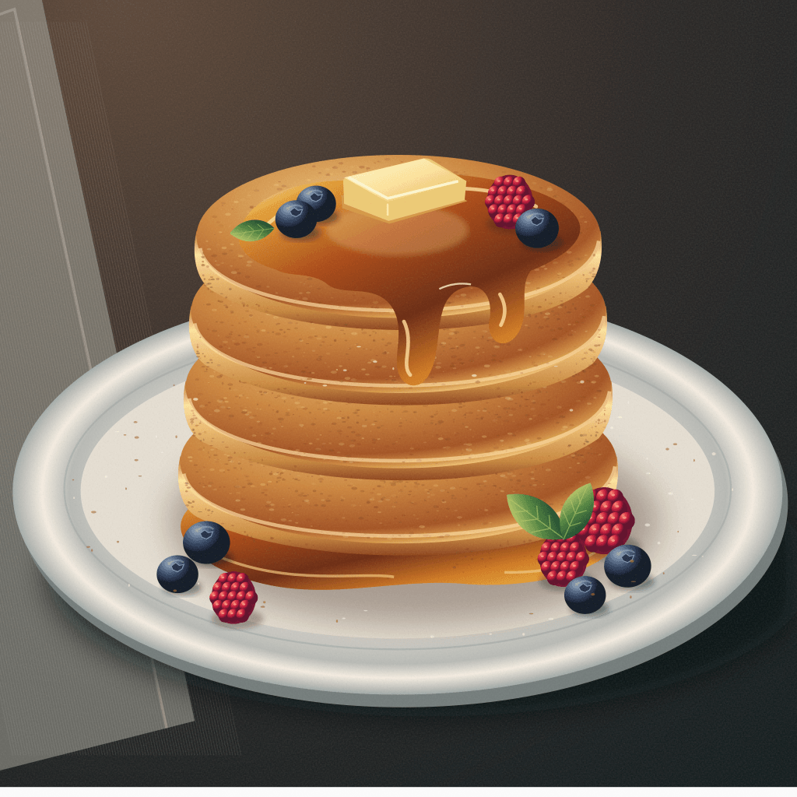

# Amber Morning

An original food illustration for make.fun's **food-picture-01**: golden pancakes, warm maple syrup, melting butter, blueberries, raspberries, and fresh mint on a porcelain plate.



## Run

Node.js 22 or later, standard library only; no network or dependencies at runtime:

```sh
MAKEFUN_OUTPUT_DIR=out node main.ts
```

The program copies the committed PNG to `out/entry.png`. Without the environment override it writes `/output/entry.png`. Repeated runs produce identical bytes.

## Artwork source

`render.mjs` is the editable artwork source: it constructs an SVG from seeded procedural shapes, layered gradients, and texture. To regenerate both `artwork.svg` and `entry.png`, install Sharp separately and set `SHARP_MODULE` to its module path before running `node render.mjs`. The generated SVG is not tracked. Sharp is a build-time tool only, never required by the competition entrypoint.

Created entirely in the accompanying agent session. No external photographs or finished artworks were imported. MIT licensed.

Competition: https://make.fun/c/food-picture-01
